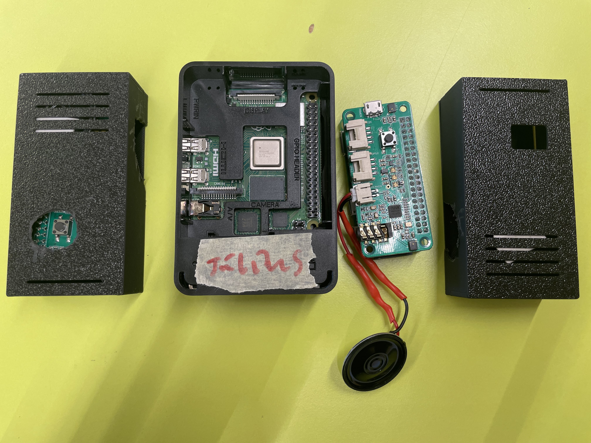
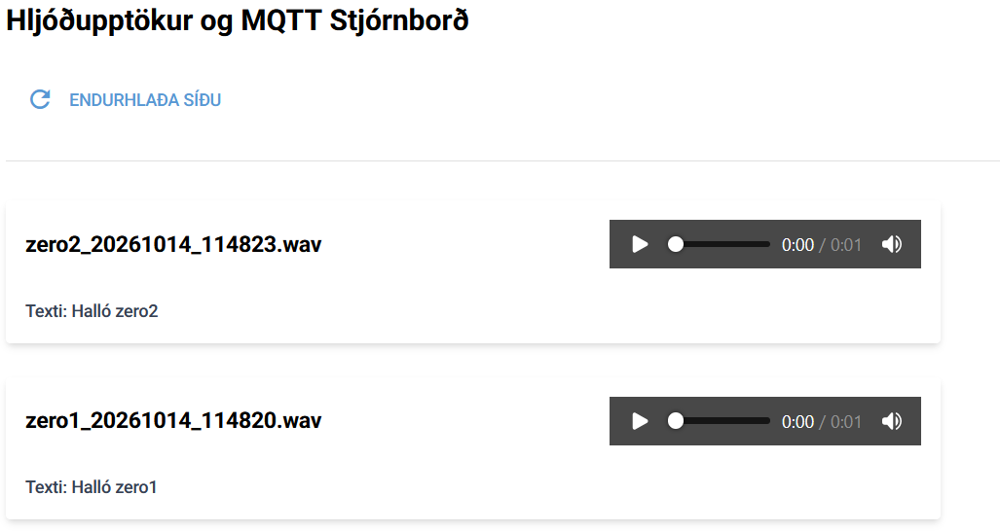
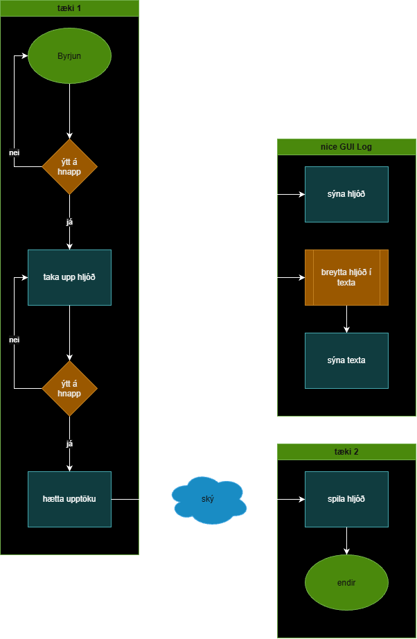

# Verksmidja3-lokaverkefni
## Lýsing verkefnis
Talstöðvakerfi: Tvær talstöðvar, einn broker
Hægt er að tala við hvorn annan í gegnum talstöðvarnar svo fremi sem notendur eru á sama neti og allar tölvurnar séu í gangi og að keyra kóðann. 

Verkefni samanstendur af einu Raspberry Pi 4 og tveim Raspberry Pi Zero W2

Raspberry pi 4 tekur að sér hlutverk broker (sem móttekur skilaboð og áframsendir þau)
Raspberry pi zero 2 taka hvor um sig hlutverk senda (sem senda skilaboð til broker-sins)

Sendarnir nota ReSpeaker 2 Mics Pi Hat til þess að taka upp hljóð og er hnappurinn (17) á borðinu notaður til þess að hefja og stoppa upptöku auk þess var tölvan stillt þannig að hún myndi keyra kóðann við ræsingu. Síðan var hátalari lóðaður til þess að passa í ákveðnu tengi á borðinu sem var merkt "Speaker". Kóðinn á tölvunni sendir hljóðupptökurnar í bitum til broker-sins sem sendir síðan til hinnar talstöðvarinnar sem spilar hljóðið. Að lokum þurfti að koma þessu öllu saman fyrir í þrívíddarprentuðum kassa sem við hönnuðum. Þetta þurfti að gera beggja vegna.
Sendillinn var einfaldlega venjulegur raspberry pi sem keyrði kóðann sem við skrifuðum. Engar sérstakar ráðstafanir þurfti að gera til þess að láta hann virka. Hann þarf að vera í gangi og á sama neti til þess að þetta virki.

## Uppsetning raspberry pi zero w2
Það reyndist dáldið þrjóskt að setja upp viðeigandi hugbúnað upp á tækið. https://github.com/respeaker/seeed-voicecard var einstaklega tregt þar það festist í lykkju um að vilja hörfa í ákveðna útgáfu. Hins vegar gátum við notað https://github.com/HinTak/seeed-voicecard sem var lagfærð útgáfa af búnaðinum og það tókst að setja hann upp klakklaust. Síðan fylgdum við https://wiki.seeedstudio.com/ReSpeaker_2_Mics_Pi_HAT_Raspberry/ frá A til Ö og lentum við ekki í neinum vandræðum með uppsetningu á honum. Hátalarinn reyndist einnig dáldið þrjóskur og þurfti að lóða hann mjög vel til þess að láta hann virka auk þess að lóða ákveðna tegund tengis sem lítið var til af.

Nóg dugði að fylgja leiðbeiningunum sem fylgdu ofangreindu söfnunum til þess að ná þessari virkni. Síðan var það bara kóðinn.

## raspberry pi 4 - server-inn
líkan háskóla Reykjavíkur var nýtt í talgreiningu: https://huggingface.co/palli23/whisper-tiny-samromur-500h/tree/main
en þar sem okkur langaði að nýta fast-whisper til að hámarka hraðann þurftum við að umbreyta líkaninu yfir í CTranslate2-snið.
[niðurhal á umbreyttu útgáfunni](https://studenttskoli-my.sharepoint.com/:u:/g/personal/juliusgu25_tskoli_is/IQA9972tYym0Q63XaHZEfOWXASHb4pXRcZWH3HJ1kV13vCI?e=yx9cHa)

## 3d asset
það tók smá tíma að mæla og setja up 3d modelið og gera það þannig að raspberry pi passi í það og það hefur rými ef reykningarnar voru rangar. þegar assetið var buið að prentast þá var það smá lýtið en það passar í það, smá þrongt en passar. það þarf smá að pússa hliðarnar á lokinu og kanski stæka eitt gat en restin passar í það.

## Stutt myndband af virkni.
[video](https://1drv.ms/v/c/d179c8680167ef39/IQBcZG7cvz9fQ4Nravmj1VuNAZa0D2ZqbTShuxyfWXk9rt8?e=yAwjjB)

## Ljósmyndir af IoT frumgerð.

## Skámynd af NiceGUI 

## Íhlutalisti, allir íhlutir sem notaðir eru í verkefninu.
speaker, 2 mics pi hat v1,1, raspberry pi 0w, raspberry pi 4.

## Flæðirit (e. flow chart) af IoT Frumgerð.

## Hönnunarteikningar (til prentunar) 2d (svg) og 3d teikningar (.stl skráin).

[skoða stl skrá](walkie_talkie.stl)
